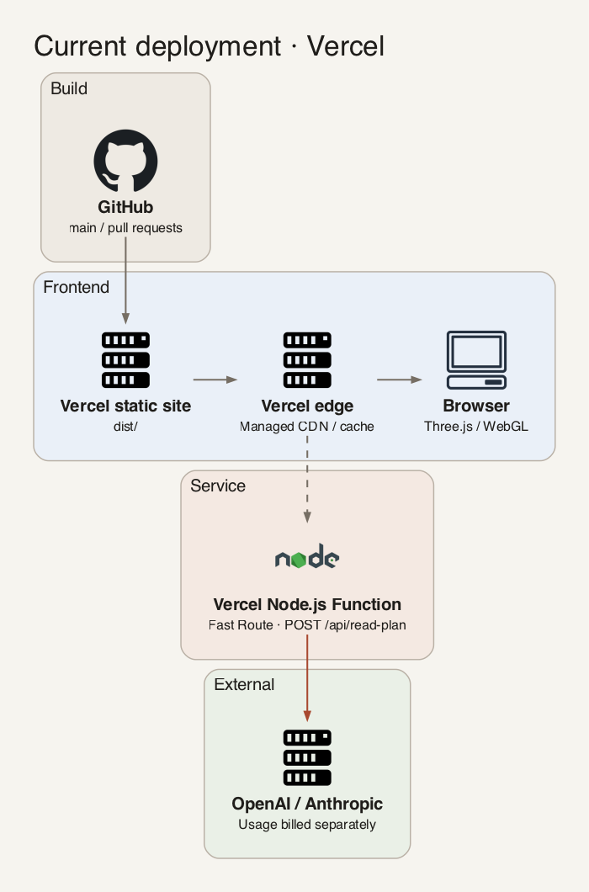
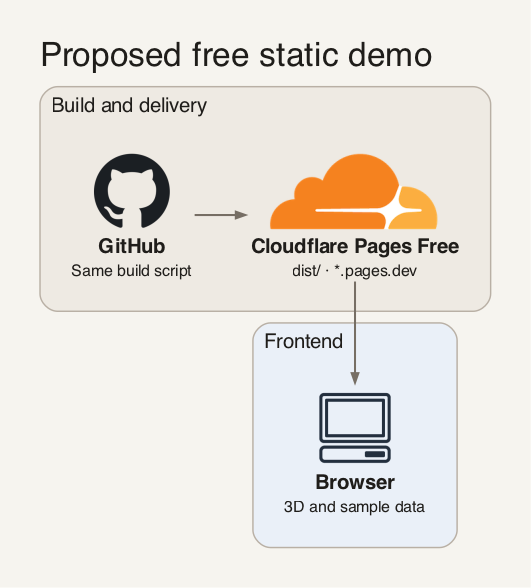
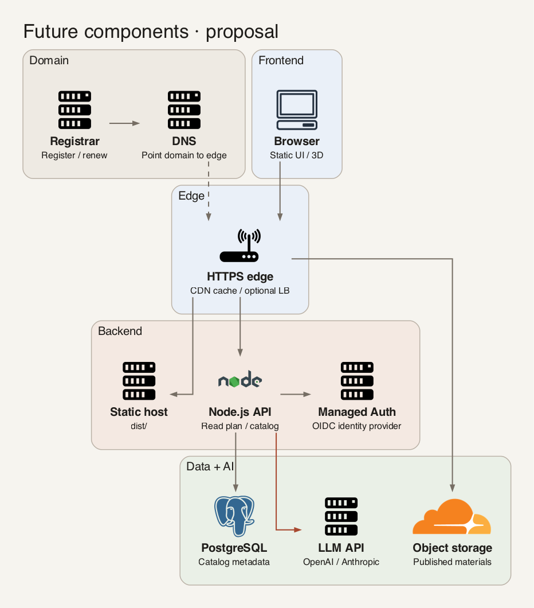
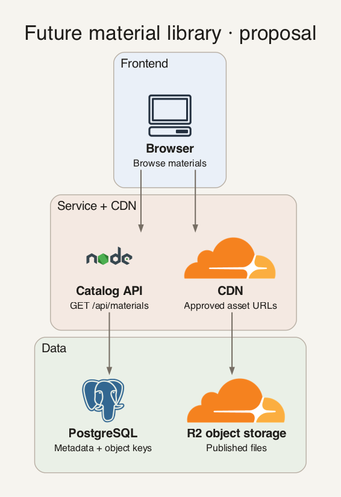

# Interior Design Agent

English · [繁體中文](README.zh-TW.md)

**[Explore the interactive proposal →](https://cathay-ai.github.io/interior-design-proposal/?v=native)**

Describe your space with **voice or text and reference images**. Explore a **3D proposal and rough budget**, with Taiwan-aware design considerations.

**Mobile-first · Desktop-ready · Paid upgrades**

[Product plan](docs/product/mvp.md) · [Team](docs/delivery/team.md) · [Roadmap](docs/delivery/roadmap.md) · [Project board](https://github.com/orgs/Cathay-AI/projects/1/views/4)

Product concept in planning. Providers, pricing and supported checks remain to validate.

## Deployment

- **Today.** GitHub → Vercel Git integration, the same delivery pattern as Music Taste Match. `main` builds production and pull requests get previews. [Build script](scripts/build-site.sh) · [Vercel config](vercel.json) · [Live prototype](https://interior-design-gules-pi.vercel.app/)
- **Start with free hosting.** Keep the existing Vercel deployment and evaluate Cloudflare Pages Free in parallel for a static demo. From the repository root, run `npm ci` if dependencies are not already installed, build with `sh scripts/build-site.sh`, and publish `dist/` to the included `*.pages.dev` address. Static requests are free and unlimited. The free plan allows 500 builds per month and 25 MiB per file. Confirm access to the organization repo and reproduce the response headers in `vercel.json` before switching traffic. Real Fast Route parsing requires a separate API and usage budget. Vercel Hobby is for personal, non-commercial use and cannot connect directly to an organization-owned Git repository. [Pages limits](https://developers.cloudflare.com/pages/platform/limits/) · [Pages pricing](https://developers.cloudflare.com/pages/functions/pricing/) · [GitHub integration](https://developers.cloudflare.com/pages/configuration/git-integration/github-integration/) · [Vercel pricing](https://vercel.com/pricing) · [Git integration limits](https://vercel.com/docs/limits#git)

Regenerate the diagrams with Graphviz on your PATH and `uvx --from diagrams==0.25.1 python docs/visual/deployment/render.py`. [Diagram source](docs/visual/deployment/render.py)

### Frontend build and runtime

The site uses HTML, CSS and native JavaScript modules. `sh scripts/build-site.sh` assembles HTML, JavaScript, styles, images and 3D assets into `dist/`. esbuild bundles the 3D retry entry, and Vercel serves the output as static files. [Build script](scripts/build-site.sh#L7-L16) · [3D retry bundle](scripts/bundle-room.mjs#L7-L20)

| Entry | What runs in the browser |
| --- | --- |
| [`/` · Quiet Oak](https://interior-design-gules-pi.vercel.app/) | Hash routes, demo uploads and estimates, and interactive Three.js/WebGL 3D. The main demo keeps its project state in memory. |
| [`/fast-route/` · Fast Route](https://interior-design-gules-pi.vercel.app/fast-route/) | Quick style selection, client-rendered 3D and browser-local progress. Floor-plan recognition uses the Function below. |
| [`/style-studio/prototype/` · Style Studio](https://interior-design-gules-pi.vercel.app/style-studio/prototype/) | Style exploration, browser-local settings and 3D preview. This entry loads Three.js from jsDelivr. |

The three production HTML entry points and `oak.js` matched the files built locally from the reference commit below.

### Backend and model invocation

1. **Packaging.** Vercel installs dependencies from the root `package.json`. The build script produces `dist/` for the frontend. In the same Vercel project, the root `api/read-plan.js` deploys separately as a Node.js Function and imports the OpenAI and Anthropic SDKs. The demo requires no separate backend package, container, database or GPU server. [Build script](scripts/build-site.sh) · [Dependencies](package.json) · [Vercel Node.js runtime](https://vercel.com/docs/functions/runtimes/node-js)
2. **Trigger.** Fast Route sends a floor-plan image or PDF from the browser to the same-origin `POST /api/read-plan`. The main Quiet Oak demo simulates floor-plan parsing and renders 3D and demo estimates in the browser. [Fast Route upload](prototype/fast-route/app.js#L382-L431) · [Quiet Oak upload](prototype/wireframe/oak.js#L353-L370)
3. **Invocation.** The Function reads server-side environment variables. With an OpenAI key it calls `responses.create`. If only the Anthropic key exists, it calls `beta.messages.stream` and waits for the final message. The Function sends the file and a structured-output schema to one provider, then returns rooms and dimensions as JSON. A failed OpenAI request does not trigger a Claude request. Failed parsing preserves existing rooms or uses the demo template for the initial attempt. Model usage is billed separately. [Model calls and routing](api/read-plan.js#L13-L67) · [Browser fallback](prototype/fast-route/app.js#L413-L425)

The production route returned HTTP 405 to a GET request, as designed. This verifies that the Function responds. Provider configuration and successful model invocation with a real file remain unverified. [Reference commit](https://github.com/Cathay-AI/interior-design/commit/034a1c42ea3dd1b8dd4e925a2ab2f0c79411b55f)

### Components and deliverables

| Component | Today | Future deliverable |
| --- | --- | --- |
| Domain, edge and load balancing | Vercel provides the default domain and managed ingress. The site homepage returned `x-vercel-cache: HIT`. | Registrar handles registration and renewal. DNS points to the TLS and CDN ingress. Keep managed routing with one origin. Add a load balancer, health checks and failover when multiple origins or regional resilience are needed. |
| Frontend and cache | The static `dist/` ships independently. Read-plan responses use `no-store`. | Long CDN caching for versioned public files, revalidation for HTML, and short CDN caching for public catalog GETs if freshness permits. Keep auth, private files and read-plan responses out of shared caches. Start with the CDN cache. |
| Backend API and LLM API | The same-origin Vercel Node.js Function handles `POST /api/read-plan` and calls the model from the server. | Deliver Node.js HTTP handlers, an OpenAPI contract and an environment-variable template. Keep model adapters on the server, with provider configuration, quotas and usage alerts. The Function is the first deployment form. |
| Auth | Demo flows have no account service. | Add a managed OIDC provider when login, cross-device progress or moderation is needed. Deliver callback and role configuration, with identity and access checks in the API. |
| DB and object storage | Sample data ships with the frontend. Some progress stays in the browser. | Deliver PostgreSQL schema, SQL migrations and a backup/restore procedure. For binary assets, deliver S3-compatible bucket configuration, permissions and an object manifest. |

Start with a free static demo. Add services and budget as sign-in, searchable assets, or real AI parsing become necessary. The optional load balancer is for multiple origins. [Vercel CDN](https://vercel.com/docs/cdn) · [Cache headers](https://vercel.com/docs/headers/cache-control-headers) · [Load-balancing components](https://developers.cloudflare.com/load-balancing/understand-basics/load-balancing-components/) · [OIDC](https://openid.net/specs/openid-connect-core-1_0.html)

### Migration options

1. **Frontend and API.** Republish the same `dist/` to another static host. Keep the Node.js handlers behind a Vercel request/response adapter. When moving compute, replace the adapter and preserve paths, response contracts and timeout tests.
2. **Data and identity.** Rehearse PostgreSQL backup/restore and verify row counts. Copy objects by key and compare the manifest. Map the OIDC `issuer` and `subject` to an internal user ID, and verify account mapping and sign-in before changing providers. Rehearse integrity checks, the write pause and rollback with your actual data volume. [PostgreSQL dump](https://www.postgresql.org/docs/current/app-pgdump.html) · [S3-compatible API](https://developers.cloudflare.com/r2/api/s3/api/)
3. **Traffic.** Verify HTTPS, sign-in, asset delivery and read-plan on a staging domain. Keep the custom domain and switch DNS or the managed ingress to the new origin. Rehearse rollback and keep the old origin until verification is complete.

### Future material library

1. **Frontend.** The browser calls `GET /api/materials` for filters and item metadata, then uses returned versioned URLs to load approved thumbnails, textures and GLB models directly from the CDN.
2. **Service.** Start with a catalog API in the existing Vercel project. It returns published items only. A publishing flow can stage uploads in private object storage, approve the asset and its license, then publish the approved version and its catalog record. The existing read-plan Function continues to handle model calls.
3. **Data.** Use PostgreSQL for searchable metadata such as ID, material category, style, dimensions, source, license, version, publish status and object key. Keep image and model files in S3-compatible object storage. Cloudflare R2 is one option. Use separate public and private buckets so staged files and customer floor plans stay outside the public catalog. [PostgreSQL indexes](https://www.postgresql.org/docs/current/indexes-intro.html) · [R2 public buckets](https://developers.cloudflare.com/r2/data-access/public-buckets/) · [R2 signed URLs](https://developers.cloudflare.com/r2/api/s3/presigned-urls/)

Keep the current demo assets in `dist/` until the catalog needs independent updates, search, or asset approval. The proposed API and storage are future work.

### Domain and DNS

1. **Prototype.** Use the current Vercel URL or the included `*.pages.dev` address for a Cloudflare static preview. Domain registration costs nothing at this stage.
2. **Public launch.** Reuse an organization-owned subdomain if one is available. For Cloudflare Pages, add the subdomain to the Pages project first, then point a DNS CNAME record to `<project>.pages.dev`. This can use the existing DNS provider. Using an apex domain such as `example.com` directly on Pages requires Cloudflare nameservers. For the full prototype on Vercel, add the domain to that project and use the DNS records it displays. [Cloudflare Pages custom domains](https://developers.cloudflare.com/pages/configuration/custom-domains/) · [Vercel custom domains](https://vercel.com/docs/domains/working-with-domains/add-a-domain)
3. **New brand domain.** Cloudflare Registrar lists standard `.com` registration at **US$11.17 for the first year** and **US$11.17 for renewal** as of 2026-11-20. Confirm the chosen name, availability, final checkout price and renewal before purchasing. It uses Cloudflare nameservers. [Registrar pricing](https://pricing.registrar.cloudflare.com/?q=com) · [Registrar requirements](https://developers.cloudflare.com/registrar/get-started/register-domain/)

Before sharing the new address, verify HTTPS and the intended site entry points. Fast Route browser-saved progress is tied to the original site address, so a custom domain starts with separate browser storage.
