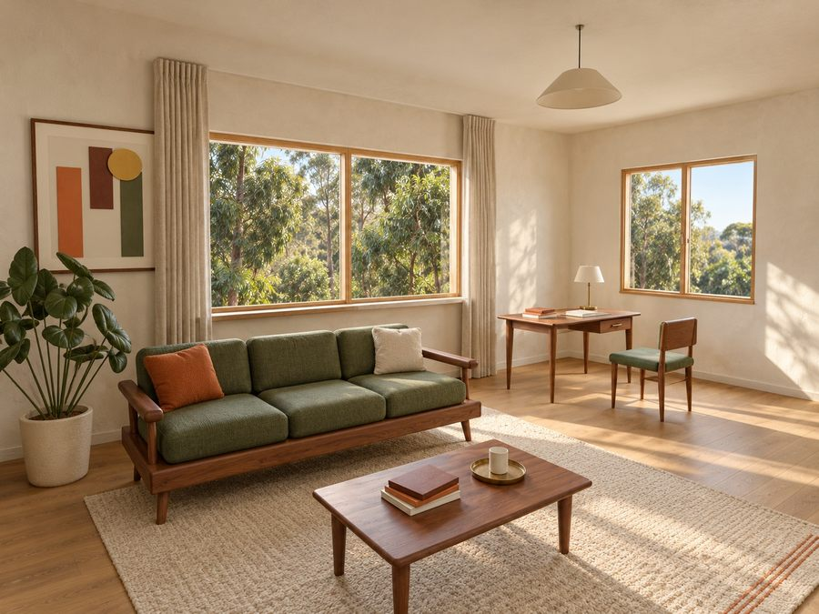
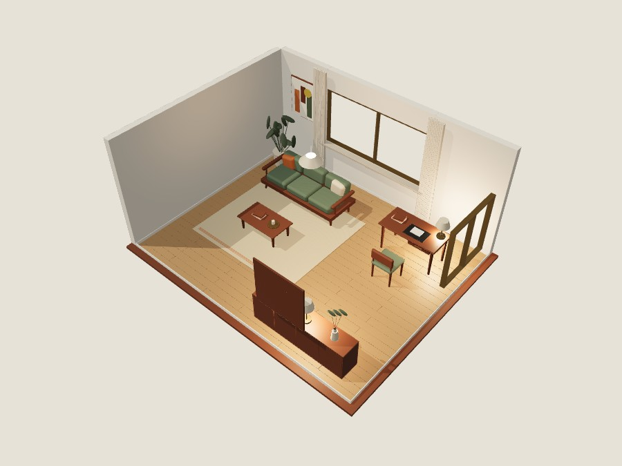
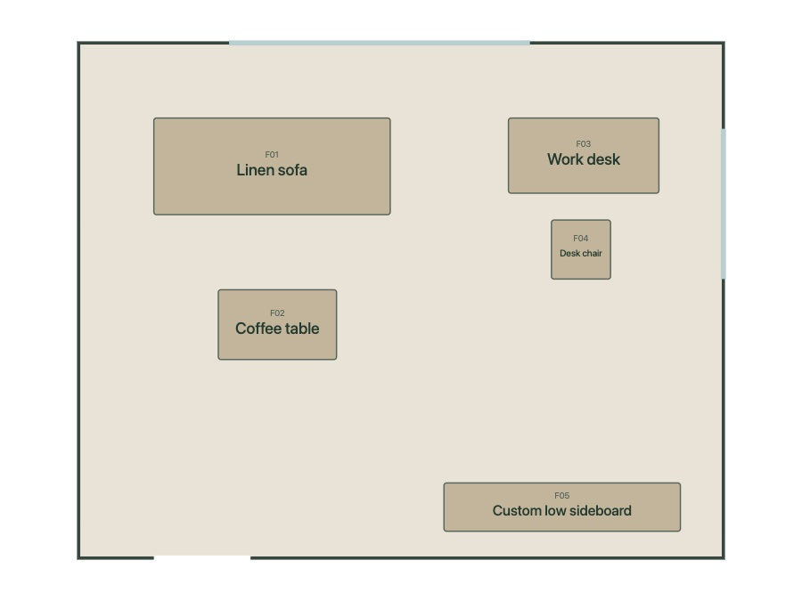
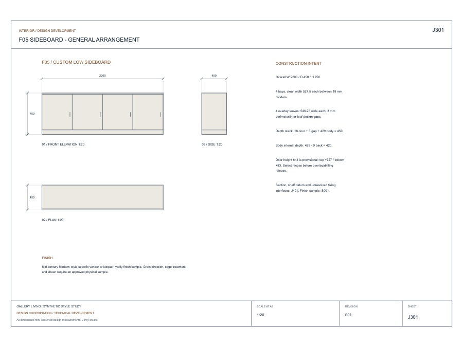
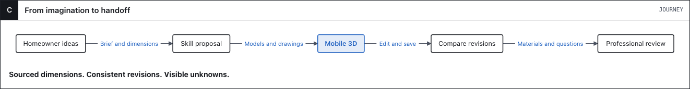
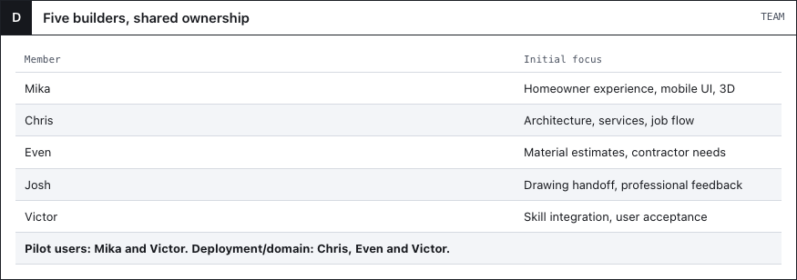
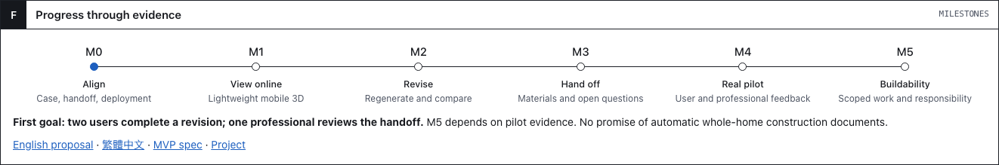

# From ideas to a space people can act on

**Interior Design Agent · Proposal v0.1 · 2026-11-05**

English · [繁體中文](README.zh-TW.md) · [Browser proposal](visual/proposal.en.html) *(download and open)*

| The idea | The space |
|:---:|:---:|
|  |  |
| **The layout** | **The detail** |
|  |  |

*Existing skill’s synthetic outputs — not the finished platform or approved construction documents. [Sources](visual/assets/README.md).*

**Why:** homeowners have ideas; professionals need dimensions, decisions and a traceable brief.

**Our bet:** combine Victor’s skill, lightweight mobile review, consistent revisions and local professional feedback. Chat, images and 3D alone are not the differentiation.

**Business hypothesis:** a homeowner-facing tool leading to paid review or services. Pricing and demand remain unvalidated.

**MVP goal:** two internal homeowners complete a review–revise–compare loop; one consenting professional reviews the handoff. Construction readiness is a later, scope-specific gate.

[Project board](https://github.com/orgs/Cathay-AI/projects/1/views/4) · [MVP](product/mvp.md) · [Architecture / mobile](engineering/architecture.md) · [Team](delivery/team.md) · [Roadmap](delivery/roadmap.md)

Detailed specs currently use Traditional Chinese. [Full rationale / 產品背景](proposal-background.zh-TW.md).
