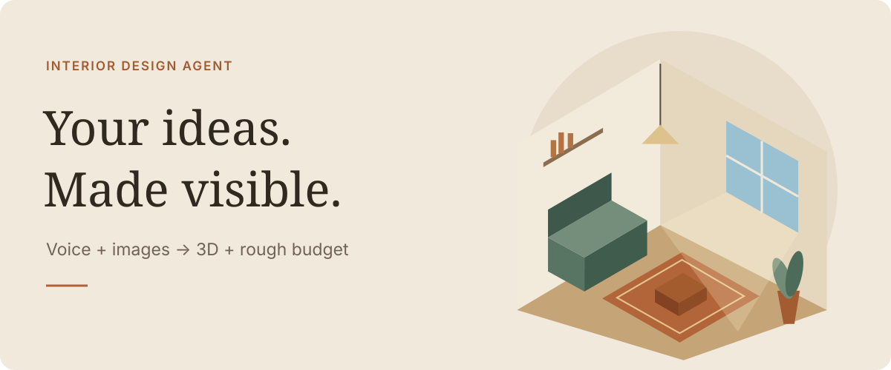

# Interior Design Agent · Proposal

English · [繁體中文](README.zh-TW.md)

**[Open the 29-page HTML proposal →](https://cathay-ai.github.io/interior-design-proposal/?v=native)** · [Original PDF](proposal/assets/original-proposal.pdf)

**The experience:** voice/text + references → 3D + rough budget → optional paid upgrades.

**The product bet:** easy to start, with Taiwan-specific space, regulation, fire safety and MEP considerations. Supported checks and pricing remain to validate.

**The first milestone:** Mika and Victor complete the basic flow; validate budget clarity and willingness to upgrade.

[Product & MVP](product/mvp.md) · [Team](delivery/team.md) · [Roadmap](delivery/roadmap.md) · [Architecture](engineering/architecture.md) · [Knowledge sources](engineering/taiwan-knowledge.md) · [Project](https://github.com/orgs/Cathay-AI/projects/1/views/4)

Product concept, not a live design service. Detailed specifications currently use Traditional Chinese.
