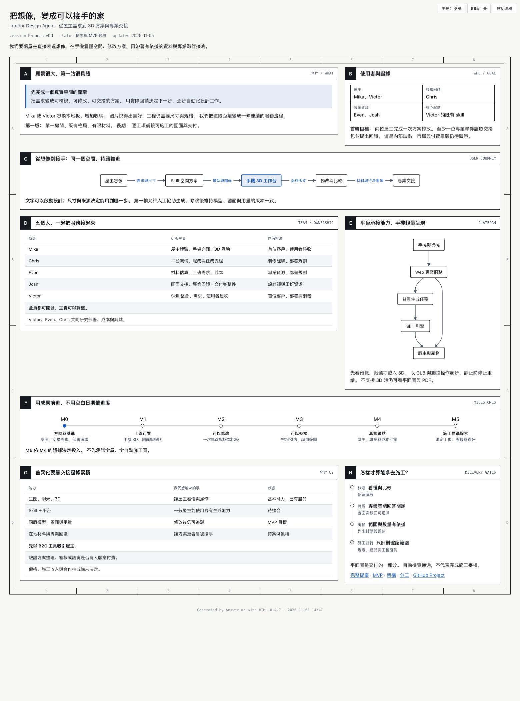
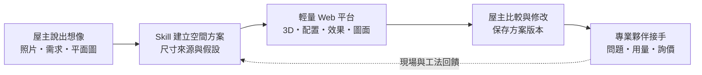

# 從「我想要這樣的家」到「我們知道下一步怎麼做」

> **Interior Design Agent｜AI 室內設計服務提案 v0.1**

> 2026-11-05 · Mika / Chris / Even / Josh / Victor

> 初始方向與高層分工已獲授權；商業模式、工期與施工交付範圍仍需驗證。

[打開視覺化提案](visual/proposal.html) · [產品規格](product/mvp.md) · [開始分工](delivery/team.md) · [追蹤進度](https://github.com/orgs/Cathay-AI/projects/1)

HTML 需下載後以瀏覽器開啟；下方圖片與 Mermaid 可直接在 GitHub 閱讀。HTML 是提案，不是產品 demo。

## 起點：屋主有想像，工程需要答案

想像 Mika 或 Victor 準備規劃自己的空間。他知道想要溫暖的木地板、更多收納，也有幾張喜歡的照片。但他很難把想像整理成尺寸、配置、材料與工班能理解的需求。

漂亮圖片能幫他表達偏好，卻還不能回答：放得下嗎？改動會影響哪些地方？材料費怎麼來？師傅下一步需要確認什麼？

我們想縮短的，就是**想像、空間方案與專業交接之間的距離**。

## 願景與第一站

**願景：讓屋主更直接地實現空間想像，逐步自動化前期設計與文件工作，並銜接可信任的施工資源。**

第一站不是建立完整統包公司。第一站是讓一個真實的單房案例，從需求走到可檢視、可修訂、可供專業夥伴討論／詢價的交付包。

Victor 希望 skill 能承擔更多原本由設計師完成的工作。平台要讓這些能力變成一般屋主能操作的服務；是否能省下哪些工作、是否達到特定工項的施工標準，須用真實案例驗證。

## 誰先使用？誰幫我們驗證？

| 角色 | 第一批人選 | 要驗證的事 |
|---|---|---|
| 屋主／使用者 | Mika、Victor | 是否看得懂、改得動、願意拿成果繼續討論 |
| 產品與技術實作者 | 全體五人 | 是否能以 side project 的成本持續交付 |
| 裝修經驗回饋 | Chris | 實際決策、預算與溝通有哪些摩擦 |
| 專業夥伴入口 | Even、Josh 的設計師／工班資源 | 缺哪些資料才能詢價、接手或施工 |

Mika、Victor 是首批驗證使用者，不代表已完成市場需求驗證。專業資源存在，也不等於已有正式合作或已承諾審查。

## 我們怎麼讓想像落地？

可以從文字開始；沒有尺寸的部分標為假設。需要計量與施工交接時，再補足現場尺寸與產品資料。效果圖不能反推成已驗證尺寸。

## 為什麼是我們？

**我們有機會把四種資源接在一起：會開發的人、會生成的 skill、真實屋主，以及能指出落地問題的專業夥伴。**

| 層次 | 已知起點 | 待建立的差異化 |
|---|---|---|
| 想像 → 方案 | Victor 的 skill 已有 3D、視覺與尺寸圖工作流程 | 讓一般屋主不必操作 agent 開發工具 |
| 方案 → 一致的資料 | Skill 已記錄來源、版本、待決事項 | 修改後保持模型、圖面、用量與狀態一致 |
| 資料 → 專業接手 | Even、Josh 有設計師與工班資源 | 以實際夥伴回饋累積材料、交接規格及問題案例 |
| 接手 → 施工 | 是長期目標 | 逐工項取得現場、產品、工法與負責人確認 |

ChatGPT 已支援圖片生成與編輯；既有室內設計產品也提供 3D。**「能聊天、能生圖、能看 3D」是基本能力，不能單獨當成競爭優勢。** 我們的差異化假設是：更容易從屋主需求走到可追溯、可交接的在地服務流程。[ChatGPT 官方能力](https://help.openai.com/en/articles/11084440-images-in-chatgpt) · [Homestyler 官方功能](https://www.homestyler.com/solution/design_floor-planner?lang=en_US)

## MVP：完成一個真實空間的閉環

Mika／Victor 提供一個單房需求 → skill 生成 → 手機開啟平台 → 看 3D／圖面 → 提出並完成一次修改 → 比較版本 → 查看有依據的材料預估 → 交給專業夥伴回饋。

第一版允許人工協助整理輸入、執行 skill 與核對資料。先驗證服務價值，再決定哪些步驟值得自動化。

- **一定要有：** 輕量手機檢視、真實檔案、版本追溯、可見的未知事項，以及專業回饋。
- **先縮小：** 一個空間、既有格局、牆地材等有限材料、限定支援的修改。
- **後續再做：** 全屋全自動建模、全套機電設計、直接發行施工圖、工班媒合與工程管理。

## 商業模式：工具入口，服務驗證

短期採 B2C 入口、專業夥伴協作的試點。測試屋主是否願意為方案整理、專業審核或諮詢付費；尚未定價，也不預設設計師訂閱制。

長期才評估設計服務、材料合作、媒合或施工服務收入。每條路分別記錄付費者、成本、責任與成交證據。免費生成量不能取代付費驗證。

## 團隊如何前進？

| 成員 | 初版主責 | 搭配角色 |
|---|---|---|
| Mika | 屋主體驗、手機介面、3D 互動 | 首位使用者、UX 驗收 |
| Chris | 平台架構、服務與任務流程 | 裝修經驗、部署共同主責 |
| Even | 材料估算、工班需求與成本假設 | 專業夥伴訪談、部署共同主責 |
| Josh | 圖面交接、專業回饋與交付完整性 | 設計師／工班資源 |
| Victor | Skill 整合、需求與使用者驗收 | 首位使用者、部署與網域共同主責 |

所有人皆可開發。上述是初版主責，不是技術能力限制，也不代表成員具有施工簽核資格。Victor、Even、Chris 共同規劃部署、成本與網域；購買服務及網域前另確認支出與持有人。

## 用成果推進，不先承諾日期

**成功的第一步：** 兩位內部屋主能完成看方案、提修改、再比較的流程；至少一位專業夥伴能指出該版本可如何使用、缺什麼資料。詳細驗收見 [MVP](product/mvp.md)。

下一步以 [roadmap](delivery/roadmap.md) 和 [GitHub Project](https://github.com/orgs/Cathay-AI/projects/1) 協作。這版是可執行的起點，最終產品依真實回饋收斂。
