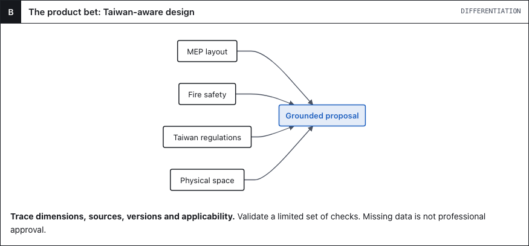

# Your ideas → a 3D proposal → a rough budget

**Proposal v0.2 · Taiwan-aware AI space design · 2026-11-05**

English · [繁體中文](README.zh-TW.md) · [Browser proposal](visual/proposal.en.html) *(download and open)*

**For homeowners exploring renovation ideas.** Use voice or text and reference images, on a phone or computer. A floor plan is optional at the start.

**Our product bet:** combine easy input with space, Taiwan regulations, fire safety and MEP considerations. Every supported check needs sources and applicability; this is not automatic professional approval.

**Free core:** a basic 3D proposal and rough budget range. **Paid:** advanced features, with bundles, quotas and prices still to validate. Real customer cases require consent; none are claimed yet.

**First goal:** Mika and Victor complete the basic flow on phone and desktop; test rough-budget clarity and willingness to upgrade. No generation engine is selected.

[Project](https://github.com/orgs/Cathay-AI/projects/1/views/4) · [MVP](product/mvp.md) · [Architecture](engineering/architecture.md) · [Team](delivery/team.md) · [Roadmap](delivery/roadmap.md) · [Knowledge sources](engineering/taiwan-knowledge.md)

Detailed specifications currently use Traditional Chinese.
