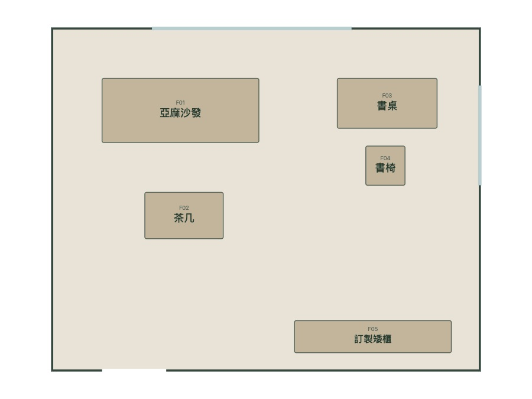
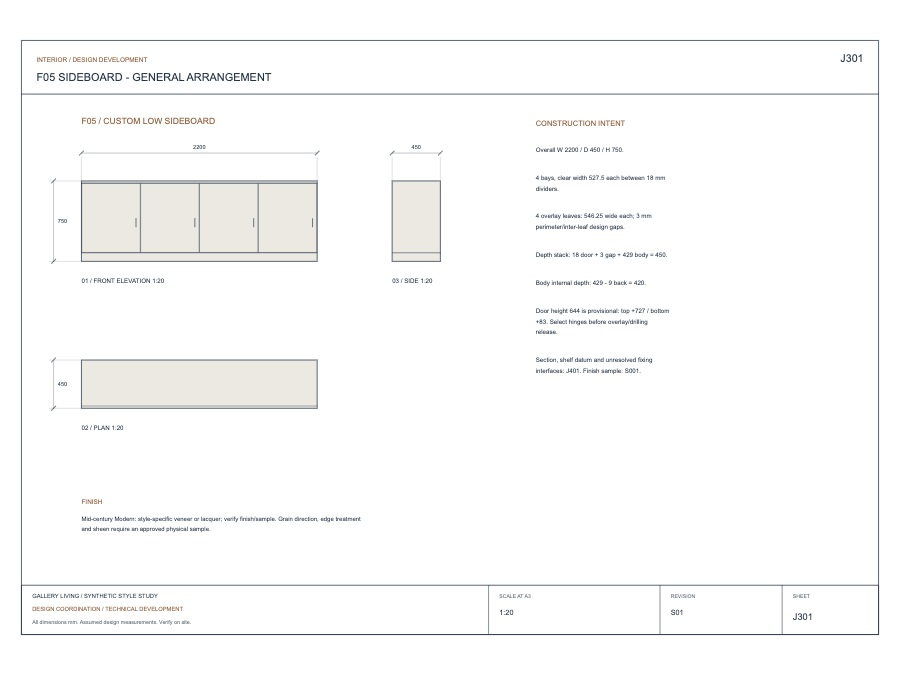

# 把想像，變成可以接手的家

**Interior Design Agent · 提案 v0.1 · 2026-11-05**

[English](README.md) · 繁體中文 · [瀏覽器提案](visual/proposal.html)（下載後開啟）

| 想像家的樣子 | 用 3D 看懂空間 |
|:---:|:---:|
|  |  |
| **變成配置** | **接上細節** |
|  |  |

*圖片是既有 skill 的虛構範例，並非已完成的平台或已核准施工圖。[來源](visual/assets/README.md)。*

**動機：** 屋主有想像，專業者需要尺寸、決策與明確需求。

**差異化假設：** Victor 的 skill＋輕量手機體驗＋同版模型／圖面／用量＋在地專業回饋。聊天、生圖、3D 本身不構成優勢。

**商業假設：** 屋主工具作入口，驗證專業審核或後續服務付費；價格與市場需求尚未驗證。

**MVP 目標：** Mika、Victor 各完成檢視／修改／比較，至少一位專業夥伴回饋交接包。施工交付依工項逐步驗證。

[看板](https://github.com/orgs/Cathay-AI/projects/1/views/4) · [MVP](product/mvp.md) · [架構／手機](engineering/architecture.md) · [分工](delivery/team.md) · [Roadmap](delivery/roadmap.md) · [完整背景](proposal-background.zh-TW.md)
