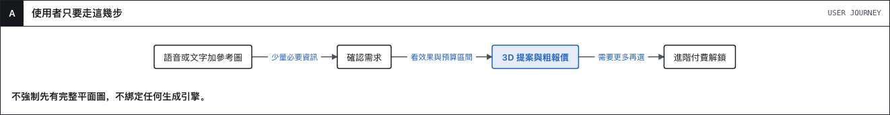
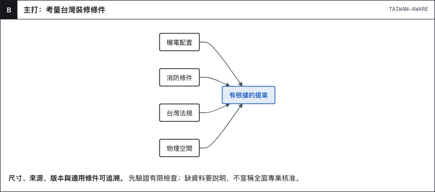
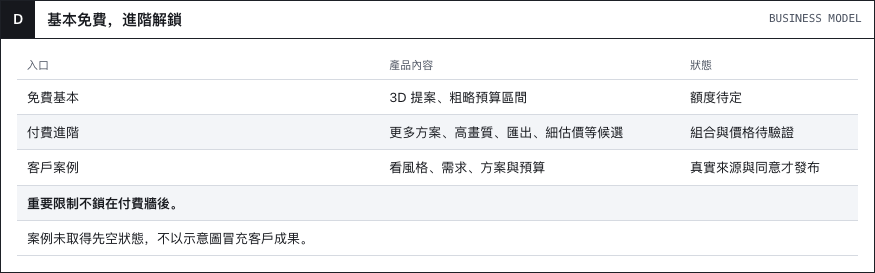
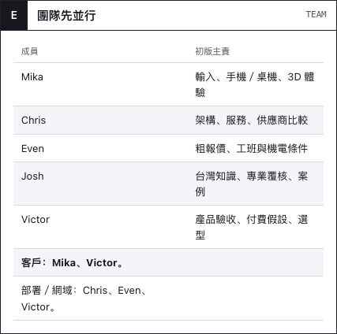
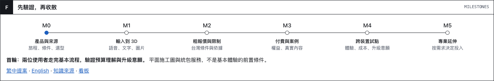

# 說出想像，看見 3D 與預算

**提案 v0.2 · 考量台灣裝修條件的 AI 空間設計服務 · 2026-11-05**

[English](README.md) · 繁體中文 · [瀏覽器提案](visual/proposal.html)（下載後開啟）

**給想探索裝修方向的屋主。** 手機、電腦都可用；語音／文字加參考圖片就能開始，不強制先有完整平面圖。

**差異化假設：** 容易使用，同時考量空間、台灣法規、消防與機電。支援的檢查保留來源與適用條件，結果不是自動取得專業核准。

**免費基本成果：** 3D 提案＋粗略預算區間。**進階付費：** 功能組合、額度、價格待驗證。客戶案例需有真實專案與展示同意，目前不宣稱已有案例。

**首輪目標：** Mika、Victor 在手機與電腦走完基本流程，驗證預算是否易懂與升級意願。生成引擎保持彈性。

[看板](https://github.com/orgs/Cathay-AI/projects/1/views/4) · [MVP](product/mvp.md) · [架構](engineering/architecture.md) · [分工](delivery/team.md) · [Roadmap](delivery/roadmap.md) · [知識來源](engineering/taiwan-knowledge.md)
