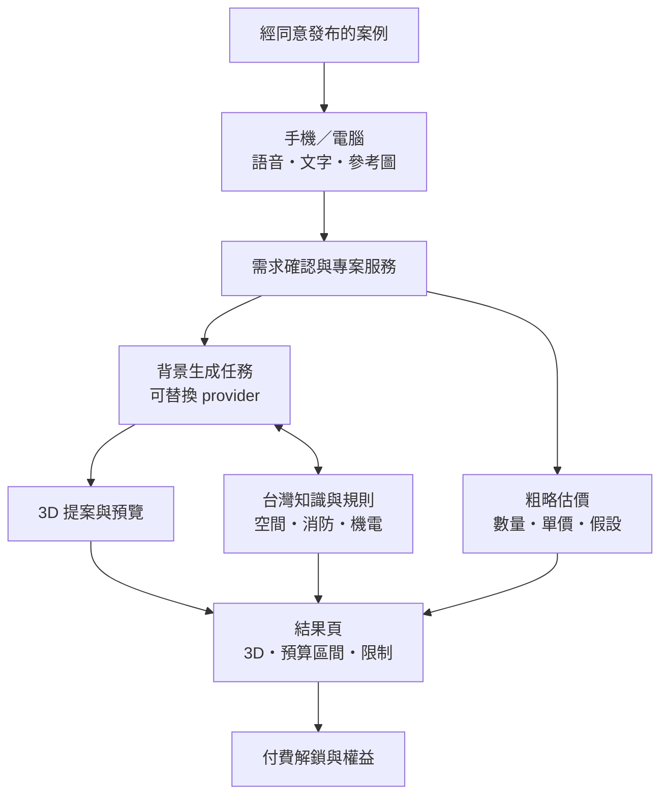

# 平台架構 v0.2：先定體驗，保留引擎彈性

狀態：候選架構，尚未實作、選定供應商或部署。Victor 的 skill 僅是早期想像與研究參考，不是產品前提。

## 模組邊界

| 模組 | 責任 | 保留彈性 |
|---|---|---|
| Intake | 語音轉文字、圖片、簡短需求確認 | 可切換 STT；不強迫先提供 CAD／平面圖 |
| Generation | 需求轉 3D 視覺提案，追蹤任務與來源 | 不指定 skill、模型或供應商 |
| Viewer | 手機觸控與桌機檢視，預覽優先 | 互動 GLB 或多角度呈現待 M0 選型；如實標示可操作能力 |
| Quote | 有依據的預算區間與排除項 | 人工確認的早期費率表也可；不可讓 LLM 憑空報價 |
| Knowledge / rules | 檢索來源、判斷適用性、執行有限可驗證檢查 | KB／官方來源／幾何檢查可替換；不等於串 RAG 就全部符合規範 |
| Entitlements | 試用額度、付費權益、回呼與退款狀態 | 方案、金流及價格未定；MVP 用 sandbox 驗證 |
| Cases | 案例內容、同意與發布狀態 | 未取得案例先空狀態，不拿內部 demo 冒充客戶 |

## 共同資料

需求、圖片、尺寸假設 → 方案 revision → 視覺／模型 artifacts → quote revision → rule findings。每份結果保留來源與時間，不能把不同版本混成同一結果。帳號／權益、發布同意與私人專案分開；公開案例只取經批准的內容。

缺面積、地區、工項或現況時，估價不能只給貌似精準數字。物理判斷需要實際幾何／尺寸；沒有資料時回傳待確認。

## Mobile first, desktop ready

- HTTPS 網頁支援錄音、可編輯逐字稿；拒絕麥克風與不支援瀏覽器保留文字路徑。
- 圖片支援相簿、拍照與電腦選檔；先預覽並控制上傳大小，不將整套原圖當首屏必載。
- 先顯示輕預覽，再按需載入 3D／多視角內容；高擬真效果預先產生，首版不做即時 path tracing。
- 觸控／滑鼠均可操作，不依靠 hover；處理載入、生成中、重試與替代檢視。
- 如選互動模型：限制紋理、模型大小與像素比；畫面靜止時停止持續重繪。
- 首輪以 390px、768px、1440px viewport 加實際 Android Chrome／iPhone Safari 測量；桌機至少一個代表瀏覽器。模擬 viewport 不替代實機 3D 測試。

初始效能預算仍是提案：非 3D 首屏壓縮資源 ≤ 1 MB；互動模型若採用，單次目標 ≤ 5 MB；10 Mbps／150 ms RTT 下主要內容 ≤ 3 秒、點 3D 到可用 ≤ 5 秒。M0 依呈現形式校準，尚未實測達標。

## 部署與網域

Chris、Even、Victor 共同評估 Web／API／worker／儲存／認證／STT／生成與付款 provider；決定環境、每案成本、預算上限、管理權、備份及資料留存。網域先列候選、持有人、費用、續約與 DNS 管理，未購買。API key 留在服務端；權益不能只由前端開關控制。

## 尚未選定

技術棧、生成引擎、STT、3D 格式、部署商、金流、價格、免費額度、首批法規檢查、價格資料與外部 KB 連接方式。先用共同驗收案例比較候選，不能把某個 contributor 的既有實作直接當選型結果。
