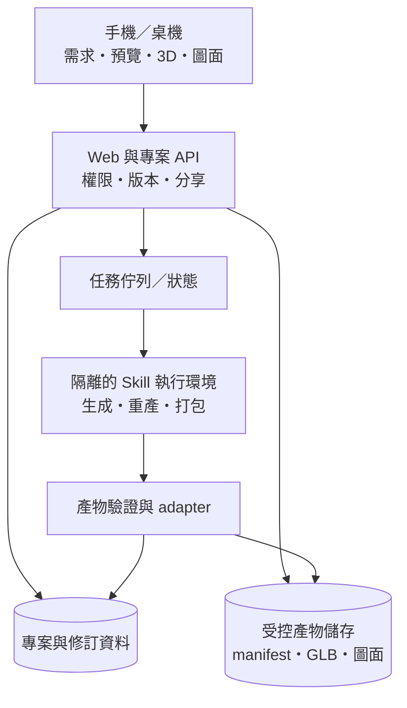

# Serving platform 與輕量呈現架構 v0.1

日期：2026-11-05。這是候選架構與平台需求，不代表已選定框架、供應商或已部署。

## Repo 邊界

本 repo 提供屋主與專業夥伴使用的 Web 平台。外部 skill 提供生成／打包流程；先以產物 adapter 整合，後續再串執行任務。先不將 skill 整包複製進 repo，也不把上游 loopback server 直接當成公開服務。

## 第一步：接收產物，第二步：提供生成服務

1. M1：人工生成／上傳經整理的產物包，平台驗證並提供手機檢視。
2. M2：記錄修改請求，允許人工輔助執行；選定 provider／host 後逐步改成背景任務。
3. 任何方式都保留 `queued / running / succeeded / failed` 等明確狀態；新版本完整驗證後才發佈。這些是平台建議狀態，不冒充上游既有 API。

上游需要 host 工具才能生成新效果圖；demo 不呼叫影像 API。Blender 只用於相應 native／建模流程，不能假設每次查看都要跑 Blender。

## 最小資料概念

Project（需求／使用者）→ Revision（不可變方案版本）→ Artifact（模型／圖面／表格／來源與雜湊）。另外記錄 GenerationJob、MeasurementEvidence、MaterialSelection、QuantityEstimate、ReviewIssue、ShareGrant。這是概念模型，尚未決定資料庫 schema 或 REST 路徑。

Adapter 優先保留上游 manifest 的版本、模型、圖面、變體、下載與雜湊。平台不假設一定有模型或 MEP；缺項顯示原因。原始私有 native inventory 不因分享交付包而自動公開。

## Mobile friendly 與輕量 render

- 先載入需求摘要、配置圖或預覽；切到 3D 才下載 renderer 與所選 GLB。
- 使用 WebGL 的輕量模型檢視；觸控旋轉／縮放、重設視角、剖開外殼。走入空間屬可選功能。
- 首版不做即時 path tracing、VR、高複雜物理與持續雲端串流渲染。
- 操作或載入時才要求重繪，靜止時停止持續繪製；限制手機像素比與並行模型數。
- 對大模型做幾何／紋理最佳化，保留原始交付檔；不能為壓縮而改變標示尺寸與資料來源。
- WebGL／記憶體不支援時提供預覽、平面圖及 PDF，並說明無法顯示 3D 的原因。
- 分享頁、按鈕與圖面切換支援 390px／768px／桌機寬度，不依靠 hover。

### 首輪效能預算（提案，尚未實測）

| 項目 | 初始目標 | 測量方法 |
|---|---|---|
| 首屏非 3D 資源 | 壓縮傳輸合計 ≤ 1 MB | 清快取觀察請求；不把 GLB 偷列為首屏必要資源 |
| 單次載入模型 | GLB 目標 ≤ 5 MB，超出 10 MB 先提示 | 記錄模型及另外下載的紋理總量 |
| 首屏主要內容 | ≤ 3 秒 | 記錄實機、瀏覽器及明確的節流條件 |
| 點 3D 到可操作 | ≤ 5 秒 | 以 10 Mbps／150 ms RTT 的測試條件起跑，記錄冷載入 |
| 靜止畫面 | 無持續動畫重繪 | 觀察 render loop／效能紀錄 |

裝置至少包含一支實際 Android Chrome、一支 iPhone Safari；型號與版本由團隊補上。模擬 viewport 不能替代手機 GPU、觸控與記憶體測試。以上是待校準目標，不是已達成的效能宣稱。

## 部署決策清單

共同主責：Chris、Even、Victor。

- 比較靜態／Web hosting + API + 背景 worker + 物件儲存，以及更簡單的單服務試點方案。
- 確認 skill host、Python／Node／Blender 的實際需要、模型工具權限、影像 provider 和每案成本。
- 決定測試／正式環境、管理者、機密保存、資料位置、備份／回復與費用上限。
- 住宅圖面採授權存取；短效附件網址與撤銷機制；拒絕路徑穿越、缺檔、大小／類型不合的產物。
- 帳號認證方式未定，但測試環境也不能把所有住宅資料放到無保護的公開路徑。
- 網域需記錄候選、可用性與查核日期、註冊／續約費、持有人、付款人、DNS 管理與回復方式。尚無註冊授權與選定名稱。

## 待決策與驗證

技術棧、部署商、資料庫、認證、物件儲存、worker 隔離、模型壓縮方式都由首輪比較決定。M1 先證明可安全地展示既有產物，M2 再接生成；不先建立通用 agent marketplace。
