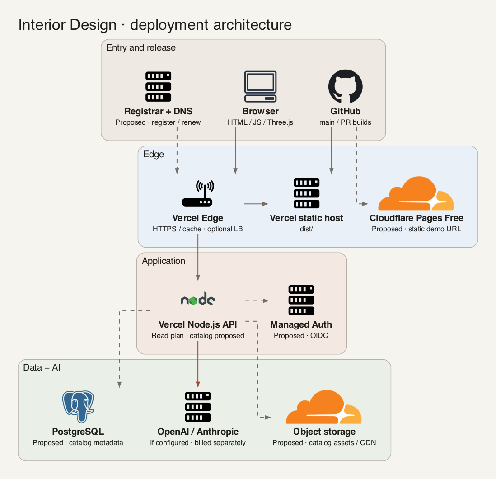

# 部署架構與操作規劃

[English](deployment.md)

實線表示現行部署路徑，模型呼叫需有供應商設定。虛線表示規劃中的服務或連線。

- **現行部署。** 採用和 Music Taste Match 相同的 GitHub → Vercel 模式。`main` 建置正式站，PR 建置預覽。[建置腳本](../../scripts/build-site.sh) · [Vercel 設定](../../vercel.json) · [目前原型](https://interior-design-gules-pi.vercel.app/)
- **免費起步。** 建議保留既有 Vercel，先平行驗證 Cloudflare Pages Free 的靜態展示。在 repo 根目錄用 `npm ci` 安裝依賴，建置命令為 `sh scripts/build-site.sh`，發佈目錄為 `dist/`，先用附的 `*.pages.dev` 網址。靜態請求免費且不限量，免費版每月 500 次建置、單檔上限 25 MiB。切換前先確認組織 repo 授權，並比對 `vercel.json` 的回應標頭。Fast Route 真實 AI 讀圖需要另外接 API 並編列用量預算。Vercel Hobby 限個人非商用，且無法直接連接 GitHub 組織擁有的 repo。[Pages 限額](https://developers.cloudflare.com/pages/platform/limits/) · [Pages 計費](https://developers.cloudflare.com/pages/functions/pricing/) · [GitHub 整合](https://developers.cloudflare.com/pages/configuration/git-integration/github-integration/) · [Vercel 方案](https://vercel.com/pricing) · [Git 整合限制](https://vercel.com/docs/limits#git)

重畫總圖需先安裝 Graphviz，再執行 `uvx --from diagrams==0.25.1 python docs/visual/deployment/render.py`。[圖檔原始碼](../../docs/visual/deployment/render.py)

## 前端打包與執行

前端用原生 HTML、CSS 和 JavaScript 模組。`sh scripts/build-site.sh` 把頁面、程式、樣式、圖片和 3D 素材組裝成 `dist/`。esbuild 負責打包 3D 重試入口，Vercel 將建置結果當靜態檔提供。[建置腳本](../../scripts/build-site.sh#L7-L16) · [3D 重試打包](../../scripts/bundle-room.mjs#L7-L20)

| 入口 | 瀏覽器負責什麼 |
| --- | --- |
| [`/` · 靜謐橡木](https://interior-design-gules-pi.vercel.app/) | 網址 `#` 後的頁內導航、示意讀圖與估價、Three.js／WebGL 互動 3D。主站的展示專案狀態存在頁面記憶體。 |
| [`/fast-route/` · 快找風格](https://interior-design-gules-pi.vercel.app/fast-route/) | 快速選風格、瀏覽器繪製 3D、以 `localStorage` 在同一瀏覽器保留進度。真正讀平面圖時會向下方 Function 送出檔案。 |
| [`/style-studio/prototype/` · 風格實驗室](https://interior-design-gules-pi.vercel.app/style-studio/prototype/) | 探索風格、在瀏覽器保留設定、預覽 3D。這個入口從 jsDelivr 載入 Three.js。 |

正式站的三個 HTML 入口與 `oak.js` 已逐檔比對，雜湊與下方基準提交的本機建置相同。

## 後端打包與 LLM 呼叫

1. **怎麼包。** Vercel 從 repo 根目錄的 `package.json` 安裝依賴。建置腳本輸出前端靜態檔 `dist/`，同一 Vercel 專案另將根目錄的 `api/read-plan.js` 部署成一支 Node.js Function，由它載入 OpenAI 與 Anthropic SDK。展示無需另建後端套件、容器、資料庫或 GPU 主機。[建置腳本](../../scripts/build-site.sh) · [套件依賴](../../package.json) · [Vercel Node.js runtime](https://vercel.com/docs/functions/runtimes/node-js)
2. **何時觸發。** 快找風格收到平面圖圖片或 PDF 時，瀏覽器送同網域的 `POST /api/read-plan`。首頁「靜謐橡木」走示意讀圖，3D 與示意估價在瀏覽器處理。[快找風格上傳](../../prototype/fast-route/app.js#L382-L431) · [主站上傳](../../prototype/wireframe/oak.js#L353-L370)
3. **在哪呼叫。** Function 從伺服器環境取金鑰。有 OpenAI 金鑰就呼叫 `responses.create`，只有 Anthropic 金鑰時才呼叫 `beta.messages.stream` 並等待完整回應。Function 把檔案與輸出格式送到選定的供應商，再回傳房間和尺寸的 JSON。OpenAI 呼叫失敗時不會切到 Claude。解析失敗時，前端保留既有房間；首次解析失敗則顯示範例。模型用量另計。[模型呼叫與選擇](../../api/read-plan.js#L13-L67) · [前端備援](../../prototype/fast-route/app.js#L413-L425)

正式站對 GET 回傳預期的 HTTP 405，確認 Function 可達；線上的供應商設定與實際檔案解析成功仍待驗證。[基準提交](https://github.com/Cathay-AI/interior-design/commit/034a1c42ea3dd1b8dd4e925a2ab2f0c79411b55f)

## 元件與交付形式

| 元件 | 現況 | 未來交付形式 |
| --- | --- | --- |
| 網域、Edge、負載平衡 | 使用 Vercel 預設網域與代管入口。站台首頁實測 `x-vercel-cache: HIT`。 | 註冊與續約交由註冊商，DNS 指向平台入口，平台終結 TLS 並提供 CDN。單一來源沿用代管路由。有第二個來源、跨區容錯需求時，再配置負載平衡、健康檢查與備援切換。 |
| 前端、快取 | `dist/` 靜態檔獨立交付。目前讀圖回應為 `no-store`。 | 版本化的公開素材設長效 CDN 快取。HTML 保留重新驗證，公開型錄 GET 依新鮮度設短快取。登入、私有檔與讀圖回應維持 `no-store`。初期使用 CDN 即可。 |
| 後端 API、LLM API | Vercel Node.js Function 同網域接 `POST /api/read-plan`，從伺服器呼叫模型。 | 交付 Node.js HTTP handler、OpenAPI 契約及環境變數範本。保持模型介接在伺服器，透過供應商設定、配額與用量告警管理。現有 Function 可作為第一個部署形態。 |
| Auth | 目前示意流程無帳號服務。 | 需要登入、跨裝置續作或素材審核時，接代管 OIDC 服務。交付回呼網址、角色與權限規格，由 API 驗證身分與存取權。 |
| DB、物件儲存 | 示意資料隨前端提供，部分進度留在瀏覽器。 | PostgreSQL 交付 schema、SQL migrations 與備份還原方式。素材二進位檔用 S3 相容儲存，交付公開及私有 bucket、權限與檔案清單。 |

先以免費靜態展示起步。有登入、可搜尋素材庫或真實 AI 讀圖需求，再加入對應服務和預算。圖上的負載平衡是多來源才啟用的選項。[Vercel CDN](https://vercel.com/docs/cdn) · [快取設定](https://vercel.com/docs/headers/cache-control-headers) · [負載平衡元件](https://developers.cloudflare.com/load-balancing/understand-basics/load-balancing-components/) · [OIDC](https://openid.net/specs/openid-connect-core-1_0.html)

## 遷移彈性

1. **搬前端與 API。** 以同一份 `dist/` 部署到新靜態主機。把 Node.js handler 與 Vercel 的請求／回應介面留在轉接層，搬主機時更換轉接層並保留 API 路徑、回應格式及逾時測試。
2. **搬資料與身分。** PostgreSQL 先備份還原並驗證筆數，物件按 key 搬遷並核對清單。站內使用內部 user ID 對應 OIDC `issuer`／`subject`，更換 Auth 供應商時另行驗證帳號對應與重新登入。資料完整性、停寫窗口與回退方式依實際資料量驗證。[PostgreSQL 匯出](https://www.postgresql.org/docs/current/app-pgdump.html) · [S3 相容 API](https://developers.cloudflare.com/r2/api/s3/api/)
3. **切流量。** 在預備網域驗證 HTTPS、登入、素材讀取及讀圖 API。保留自訂網域，切換 DNS 或代管入口指向。先測回退並保留舊來源到驗證完成。

## 未來素材庫配置

1. **前端層。** 瀏覽器透過 `GET /api/materials` 查型錄及篩選，再用回傳的版本化網址，直接從 CDN 讀取已發布的縮圖、貼圖與 GLB 3D 模型。
2. **服務層。** 初期可在同一 Vercel 專案加素材 API，只回傳已發布的品項。素材先上傳到私有暫存區，確認授權與檔案品質後，再發布該版本與型錄記錄。現有讀平面圖的 Function 繼續負責 LLM 呼叫。
3. **資料層。** PostgreSQL 存可搜尋的 ID、材質分類、風格、尺寸、來源、授權、版本、發布狀態及物件鍵。圖片與 3D 檔放 S3 相容的物件儲存，可評估 Cloudflare R2。公開素材和私有檔案使用分開的儲存桶，待審素材與屋主平面圖留在公開型錄之外。[PostgreSQL 索引](https://www.postgresql.org/docs/current/indexes-intro.html) · [R2 公開儲存桶](https://developers.cloudflare.com/r2/data-access/public-buckets/) · [R2 簽名網址](https://developers.cloudflare.com/r2/api/s3/presigned-urls/)

展示階段沿用 `dist/` 的既有素材。等素材需要獨立上架、搜尋或審核，再新增 API 與儲存。

## 網域與 DNS

1. **原型階段。** 沿用現有 Vercel 網址。Cloudflare 靜態展示如果建好，也能先用附的 `*.pages.dev` 網址，這階段網域註冊費為零。
2. **公開入口。** 如果組織有可用網域，優先借用子網域。用 Cloudflare Pages 時，先把子網域加到 Pages 專案，再於現有 DNS 設一筆 CNAME 指向 `<project>.pages.dev`。要在 Pages 直接用 `example.com` 這種根網域，需使用 Cloudflare 名稱伺服器。完整原型若留在 Vercel，就把網域加到 Vercel 專案，照它顯示的 DNS 記錄設定。[Cloudflare Pages 綁定網域](https://developers.cloudflare.com/pages/configuration/custom-domains/) · [Vercel 綁定網域](https://vercel.com/docs/domains/working-with-domains/add-a-domain)
3. **新品牌網域。** 2026-11-20 查到 Cloudflare Registrar 一般 `.com` **首年 US$11.17、續約 US$11.17／年**。購買前先確認名稱、可用性、結帳總價與續約價。透過該註冊商購買須使用 Cloudflare 名稱伺服器。[註冊與續約價](https://pricing.registrar.cloudflare.com/?q=com) · [註冊條件](https://developers.cloudflare.com/registrar/get-started/register-domain/)

公開前驗證新網址的 HTTPS 和入口。Fast Route 的瀏覽器存檔會留在原網址，新網域會開自己的存檔。
