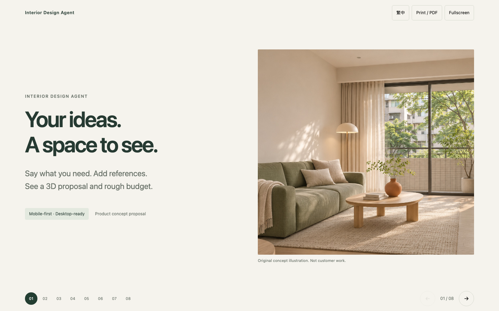

# Product proposal slides

English · [繁體中文](README.zh-TW.md)

**[Open the 8-slide deck](index.html)** · [English PDF](proposal.en.pdf) · [繁中 PDF](proposal.zh.pdf)



A compact visual proposal for Taiwan-aware AI space design. The page supports language switching, keyboard arrows, touch swipes, direct slide links, fullscreen and Print / PDF. Download this folder and open `index.html`, or serve it locally:

```sh
python3 -m http.server 8000 --directory docs/proposal
```

Visit `http://localhost:8000`. No npm installation, build, external fonts or runtime libraries.

| Slide | Story |
|---|---|
| 1 | Vision |
| 2 | Homeowner problem |
| 3 | Voice/text + images → 3D + rough budget |
| 4 | Taiwan regulations, fire safety, MEP and physical space |
| 5 | Free core, paid feature candidates and real cases |
| 6 | MVP boundaries |
| 7 | Team focus |
| 8 | Milestones and first goal |

## Published site

**[Open online](https://cathay-ai.github.io/interior-design-proposal/)** · [English](https://cathay-ai.github.io/interior-design-proposal/?lang=en#1) · [Public presentation source](https://github.com/Cathay-AI/interior-design-proposal)

The product repository stays private. Its current Free organization plan cannot host Pages from this private repository (GitHub API 422), so a separate public repository publishes only `index.html`, `.nojekyll`, the concept JPEG and a short README. Internal specifications and this directory’s notes/PDFs are not copied there.

Pages uses the public repository’s default branch root. Update only the presentation files there to republish. No custom domain or production-product deployment was changed.

## Content and image

`index.html` contains the bilingual copy, CSS and navigation. [Sources and decisions](sources.md). The hero is an original AI-generated concept, not Victor’s skill output, customer work or proof of product capability. No generation engine, actual pricing or delivery dates are selected by this deck.
