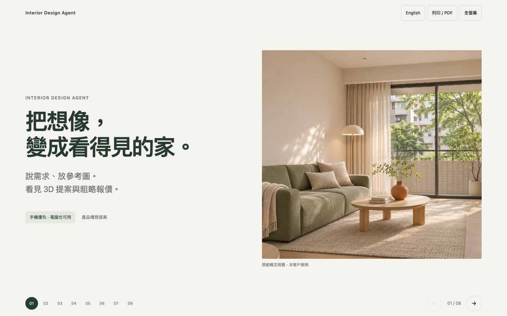

# 產品提案簡報

[English](README.md) · 繁體中文

**[開啟 8 頁簡報](index.html)** · [繁中 PDF](proposal.zh.pdf) · [English PDF](proposal.en.pdf)



支援中英文切換、鍵盤左右鍵、手機左右滑動、指定頁面連結、全螢幕與列印／PDF。下載整個目錄後開啟 `index.html` 即可，也可以從 repo 根目錄啟動：

```sh
python3 -m http.server 8000 --directory docs/proposal
```

瀏覽 `http://localhost:8000`，不需 npm、編譯或外部字型。

八頁依序是：願景、屋主痛點、使用流程、台灣條件、免費／付費、MVP、團隊、Milestones。

## 已發布

**[開啟線上簡報](https://cathay-ai.github.io/interior-design-proposal/)** · [英文版](https://cathay-ai.github.io/interior-design-proposal/?lang=en#1) · [公開簡報原始碼](https://github.com/Cathay-AI/interior-design-proposal)

產品 repo 保持私人。組織 Free 方案無法從此私人 repo 啟用 Pages（API 422），因此使用獨立公開 repo，只放 HTML、`.nojekyll`、概念圖與簡短 README，不複製內部規格、筆記或 PDF。

Pages 從公開 repo 的預設分支根目錄發布；更新該 repo 的簡報檔案即可重新發布。本次沒有購買網域或部署正式產品。

內容直接在 `index.html` 修改。[來源與範圍](sources.md)。封面是原創 AI 概念圖，不是 Victor skill 產物、客戶案例或已完成產品畫面。
